# GNN3 — substituent effects on 1,3-dipolar cycloaddition barriers, split into three channels

GNN3 is a graph neural network that predicts how a substituent changes the activation barrier of a 1,3-dipolar
cycloaddition, and why: it predicts the change in the barrier together with its split into strain, interaction and
solvation. It works on **pairs** of reactions from the same family and needs only cheap semi-empirical (GFN2-xTB)
calculations as input; it was trained on DFT energy-decomposition labels of the D1 data set (9,266 reactions).

Korean version: [README_ko.md](README_ko.md) · performance and limits: [MODEL_CARD.md](MODEL_CARD.md) · where every
function came from: [CODE_MAP.md](CODE_MAP.md).

---

## 1. What it predicts

Take a reaction **a** whose dipolarophile (or dipole) carries a substituent X, and its **H reference b**: the same
reaction with X = H at the same position (for aryl substituents: the unsubstituted phenyl). For each reaction the
activation-strain / energy-decomposition analysis splits the barrier ΔE‡ (transition state minus the separated, relaxed
reactants) into three channels:

```
  energy
    |              TS ----------------------------+
    |            /    \                           |  barrier ΔE‡ = strain + inter + solv
    |  reactants        products                  |    strain = cost of deforming both reactants to their TS shapes
    |  ----------                                 |    inter  = interaction of the two deformed fragments in the TS
    |                                             |    solv   = change of the solvation (SMD water) energy
```

GNN3 predicts, for the pair (a, b), the four differences

| output | definition (ΔΔ = value(a) − value(b)) | unit |
|---|---|---|
| `strain` | ΔΔ(d1 + d2), d1 / d2 = distortion energy of the dipole / dipolarophile | kcal/mol |
| `inter` | ΔΔ(elst + pauli + oi + disp + c_ghost): electrostatics, Pauli repulsion, orbital interaction, dispersion from the energy decomposition, plus c_ghost = interaction energy from separate fragment single points minus the EDA bonding energy (ghost-basis / BSSE shift + move into the TS solvent cavity) | kcal/mol |
| `solv` | ΔΔ(cpcm + cds): electrostatic and non-electrostatic SMD(water) terms | kcal/mol |
| `barrier` | ΔΔ(ΔE‡), predicted directly (the labels satisfy strain + inter + solv = barrier within 0.1 kcal/mol) | kcal/mol |

All values are **electronic energies** at B3LYP-D3(BJ)/def2-TZVP with SMD(water) (no zero-point, thermal or entropy
terms; not free energies). A negative `barrier` means the substituent lowers the barrier. Values are always relative
to the H reference of the same family; the model never gives an absolute barrier.

**Where DFT is used, and where not.** DFT is used only for the training labels and therefore for scoring the model:
the label TS geometries were optimised at B3LYP-D3(BJ)/def2-SVP SMD(water), and the label energies (energy
decomposition + fragment single points for strain) were computed on them at B3LYP-D3(BJ)/def2-TZVP SMD(water).
The model inputs contain **no DFT**:
the TS geometry comes from the g2 search (autodE with GFN2-xTB) and every feature from GFN2-xTB single points (plus an
xTB-level ORCA frequency job). Predicting a new pair needs xTB-level calculations only.

## 2. Pipeline

```mermaid
flowchart LR
  S["reaction SMILES<br/>(a and its H reference b)"] --> G2["g2 TS search<br/>autodE 1.4.5 + GFN2-xTB, ALPB(water)<br/>analysis/deploy/g2_deploy.py<br/>(D1: existing folders $G2/jobs)"]
  G2 --> LF["label-free finalize<br/>ORCA 6.1.1 XTB2 ALPB(water) Freq<br/>analysis/deploy/finalize_lf.py"]
  LF --> M["metadata<br/>analysis/deploy/meta_lf.py"]
  M --> F["xTB features: 182 global<br/>analysis/deploy/feat_lf.py<br/>→ X182_lf.parquet"]
  F --> T["atom tokens: 29 per TS atom<br/>analysis/deploy/tokens_lf.py<br/>→ fu2_lf/tokens/&lt;rxn_id&gt;.npz"]
  T --> E["GNN encoder (shared by a and b)<br/>gnn3/model.py GNNPairModel.encode_reactions"]
  E --> H["antisymmetric pair head<br/>f(a,b) = ½[h(r_a,r_b) − h(r_b,r_a)]"]
  H --> Y["ΔΔ strain / inter / solv / barrier<br/>mean of 5 seeds (± seed SD)<br/>gnn3/predict.py"]
```



The input stages (g2 → tokens) are run by the **existing code, unchanged**; `gnn3/inputs/pipeline.py` and
`scripts/prepare_inputs.py` fix their order, arguments and environments, can reuse finished finalize folders (3rd
argument of `jobs/prepare_inputs.sh`), and accept one documented exception: an exit 3 of `tokens_lf.py tokens` counts
as success when the only failed checks are `elements` (a subset of the 9 model elements, as in a small set of reactions)
and the dependent `d_in` (rule `i3_chain.classify_T`, called unchanged; recorded under `accepted_exceptions` in
`results/gnn3_steps/tokens.json` of the output root). Everything from the tokens on is in this package.

## 3. Glossary

| term | meaning |
|---|---|
| reaction | one D1 cycloaddition (dipole + dipolarophile, neutral), integer `rxn_id`; D1 job id `T#####` |
| pair | (a, b): a substituted reaction a and a reaction b of the same family; label = value(a) − value(b) ("ΔΔ") |
| family | reactions that differ only in the substituent X: same dipole, skeleton, series, configuration, orientation, face, … (`fam` in `S_folds.csv`) |
| H reference | b with X = H at the same position (`ref_kind = reference`); the only pairs of the headline sets P_main and P_sens_ref (the `test_all` set also contains the anchor pairs) |
| anchor pair | for families without an H reaction: pairs to one member of the family (`ref_kind = anchor`); used in training and in the `test_all` set, never in the headline P_main metrics |
| channel | strain, inter, solv (+ the barrier itself); built from the 10 DFT labels by a fixed 10×4 0/1 matrix (`channels.py`) |
| strain / inter / solv | see section 1 |
| cr2 reference structures | the separated reactants used for strain and barrier: per molecule the lowest-energy structure (at the label DFT level) found across all reactions, plus a conformer search (RDKit ETKDG → xTB → DFT) (label file `F_pairs_cr2.csv`) |
| g2 | the TS found from SMILES by autodE with GFN2-xTB (ALPB water) only; random: a rerun of 10 D1 reactions re-found the same TS for 2 of 10 (heavy-atom RMSD ≤ 0.05 Å, same forming pairs) and the same reactant references for 5 of 10 (`analysis/deploy/results/I3_chain.json`) |
| lf ("label-free") | the g2 TS finalised without any DFT information: atom order, forming bonds and fragments from the g2 run itself, plus an xTB frequency job |
| core | dipole × skeleton, e.g. `azide/B`; 46 cores have H-reference pairs in the label file (+ 4 anchor-only cores); 44 of the 46 keep P_main pairs and are the cores split into folds (and the cores of the P_main para test pairs) |
| T1 fold | 5-fold cross-validation over **cores**: the test pairs of a fold belong to cores never seen in its training |
| P_main | the main evaluation set: H-reference test pairs whose two reactions a and b both pass the label hygiene (per reaction d1 ≥ 0, d2 ≥ 0 and d2 ≤ 50 kcal/mol) |
| P_sens, P_sens_ref | P_sens = H-reference pairs before the hygiene filter (the test lists use P_sens); P_sens_ref = the P_sens test pairs as an evaluation set (ranking and cause tables); `test_all` = every test pair incl. anchors |
| T_main | the training pool of a fold: P_main H-reference pairs + anchor pairs of the training cores (`in_T_main`) |
| para / meta / ortho / direct | position of X: on the para / meta / ortho carbon of an aryl ring (`p`, `m`, `o`) or directly on the reacting fragment (`direct`) |
| seed spread | standard deviation (ddof 0) of the 5 networks' predictions; above the 95th percentile of cross-validation → `out_of_range` |
| usable reaction ("lf" rule) | has a token file that passes the build checks (all atoms, finite, exactly 2 forming bonds) and a finite 182-feature row |

## 4. Data contracts

| file | content | shape / columns | unit | source |
|---|---|---|---|---|
| `F_pairs_cr2.csv` (labels) | one row per pair | `pair_id`, `ref_kind` (reference / anchor), `a_rxn`, `b_rxn`, `pos` (p, m, o, direct), `dd_<label>` for the 10 labels d1, d2, elst, pauli, oi, disp, cpcm, cds, c_ghost, barrier, plus `dipole`, `skeleton`, `cfg`, `series`, `Xb`; 8,389 rows | kcal/mol | `/gpfs/tmp_cpu2/yeseo1ee/d1_ladder/F_pairs_cr2.csv`; accepted only if its sha256 equals `analysis/d1_ladder/results/V_report.json` |
| token `<rxn_id>.npz` | one TS | `Z` [n] int; `bin` [n, 6] int8 (frag_B, dip_a, dip_mid, dip_b, dph_a, dph_b); `num` [n, 14] float (bond_dist, q_rel, q_frag, q_TS, dq_dist, dq_int, v_rel, v_frag, v_TS, dv_dist, dv_int, mu_abs, f_plus, f_minus); `pos` [n, 3]; `edges` [e, 2] (covalent, then the 2 forming bonds); `etype` [e] (1 covalent, 2 forming); `glob` [182]; `token_version` "fu2-tokens-3-lf"; n = 8–63 atoms | `pos` Å; `bond_dist` = bonds to the nearest reacting atom (capped at 8); `q_*` GFN2-xTB Mulliken charges (e) and `v_*` Wiberg bond-order valences (dimensionless) of the atom in the relaxed reactant (`rel`), the distorted fragment (`frag`) and the TS (`TS`); `dq_dist` = q_frag − q_rel, `dq_int` = q_TS − q_frag (same for `dv_*`); `mu_abs` = \|atomic dipole\| (a.u.); `f_plus`, `f_minus` = Fukui indices (dimensionless) | `/gpfs/tmp_cpu2/yeseo1ee/ch3/lf/fu2_lf/tokens/` (8,502 files), reports in `analysis/ch3/results/lf_inputs/fu2_lf/` |
| model input per atom | one-hot of the 9 elements (H, C, N, O, F, Si, S, Cl, Br) ‖ `bin` ‖ standardised `num` → **29** values | — | `data.Standardizer.tensors` |
| `X182_lf.parquet` | the 182 global xTB features | `rxn_id` + 182 named float columns (names / order: `T_report.json glob_cols`); 8,504 rows | mixed (kcal/mol, eV, Å, e) | `/gpfs/tmp_cpu2/yeseo1ee/ch3/lf/X182_lf.parquet` |
| split `T1__f<k>.json` | one outer fold | lists of pair ids: `train`, `test`, `inner_train`, `inner_val` (first inner core-GroupKFold(4) split) | — | `/gpfs/tmp_cpu2/yeseo1ee/d1_pair/fu2/splits/`, sha256 in `analysis/d1_pair/results/fu2/S_splits.json` |
| pair attributes `S_folds.csv` | evaluation sets | `pair_id`, `core`, `fam`, `in_P_main`, `in_P_sens`, `in_T_main`, … | — | `analysis/d1_pair/results/S_folds.csv` |
| predictions `gnn3_fold<k>.parquet` (= published `KM_predictions.parquet`, rows `rung=lf3, model=GNN`) | test predictions, long format | `pair_id, ref_kind, pos, fold, rung, arm, model, target, y, yhat, base, beta, yhat_seed_sd`; one row per pair × target (`base`, `beta` = 0, kept for the original format) | kcal/mol | `scripts/train_cv.py` |
| model file `*.pt` | one network | `state` (weights), `cell`, `std` (`mu, sd` [14], `gmu, gsd` [182], `sy` [4] kcal/mol), `layout`, `d_in` 29, `d_glob` 182, `TARGETS`, `M` | — | `training.save_model_file`; the 25 published networks `/gpfs/tmp_cpu2/yeseo1ee/ch3m/units/D__lf3__S__GNN__f<k>__s<j>.pt` load unchanged |
| prediction CSV (`scripts/predict.py`) | new pairs | `pair_id, a_rxn, b_rxn, target, yhat, yhat_sd, out_of_range` (+ the excluded pairs with column `reason` in `<out>` with `.csv` replaced by `.excluded.csv`, e.g. `predictions.excluded.csv`) | kcal/mol | `predict.predict_pairs` |

## 5. Model

```
reaction (TS atoms, 29 features each; bonds; positions)                          [r, N, 29]
  atom_embedding: Linear(29 → W) + SiLU                                          [r, N, W]
  L × MessagePassingLayer (only bonded pairs exchange messages):
      e_ij = Embedding(bond type: 0 none (masked out), 1 covalent, 2 forming) + MLP(32 Gaussian RBF of d_ij, 0–4 Å)
      m_i  = Σ_j bonded  Linear(Dropout(SiLU(W_h h_j + W_e e_ij)))
      h_i  ← LayerNorm(h_i + MLP([h_i, m_i]))
  reaction vector r = [ Σ_atoms h | attention pool of h | Linear(182 → W)(standardised globals) ]   [r, 3W]
pair head h: MLP(6W → 2W → 2W → 4), SiLU, dropout 0.1
f(a, b) = ½ [ h([r_a, r_b]) − h([r_b, r_a]) ] × s_target                         [n_pairs, 4] kcal/mol
```

**Why antisymmetric.** A difference must change sign when a and b swap and must be zero for a = b. Building f as the
half difference of the head on both orders makes f(b, a) = −f(a, b) and f(a, a) = 0 hold exactly for any weights
(checked after every fit in float64: `training.check_antisymmetry`, tolerance 1e-4 kcal/mol; measured 0.0). During
training each pair is also shown in a random order with its label sign flipped accordingly.

**Loss** (`training.identity_penalty_loss`), per batch, with y and f divided by the training-pair standard deviation of
each target s (targets are scaled but not centred, so ΔΔ = 0 stays 0):

```
loss = mean |f − y|                                                   (standardised L1 over the 4 outputs)
     + λ · mean | f_barrier·s_barrier − Σ_c f_c·s_c | / s_barrier     (identity penalty, λ = 0.1, c = strain, inter, solv)
```

The penalty keeps the predicted channels consistent with the predicted barrier without forcing the barrier to be their
sum.

| hyper-parameter | value | | hyper-parameter | value |
|---|---|---|---|---|
| grid: layers L × width W | {4, 6} × {64, 128} | | optimiser | AdamW, lr 1e-3, weight decay 1e-4 |
| radial basis | 32 Gaussians on [0, 4] Å | | schedule | cosine, T_max 300 epochs (also in the fixed-length fits, which therefore stop early in the schedule; kept as published, CODE_MAP P-13) |
| dropout | 0.1 | | batch | 64 pairs |
| identity penalty λ | 0.1 | | early stopping | patience 30 epochs (tuning only) |
| seeds | 20261019 (tuning), 20261019 + 0..4 (final) | | inputs | 29 per atom (standardised numeric part), 182 global (standardised) |

All values with their sources: `gnn3/constants.py`.

## 6. Training & evaluation

**Cross-validation** (`training.run_cross_validation_unit`, one call per fold):

1. Split: the 44 cores (dipole × skeleton) that still have P_main H-reference pairs go into 5 folds; all pairs of a
   core are in the same fold.
   **Why cores:** reactions of one core share skeletons and reference reactions, so a reaction-level split would let
   near-copies of the test pairs into training; the core split measures performance on unseen dipole / skeleton
   combinations. Test = the fold's H-reference pairs (P_sens, i.e. before the hygiene filter) and anchor pairs;
   training = the other folds' P_main and anchor pairs (`in_T_main`); 6 cores are always in training: the 4
   anchor-only cores plus azomethine ylide/A and carbonyl ylide/A, which have no P_main reference pair left (only
   their anchor pairs train; `analysis/d1_pair/results/S_report.json`).
   Only usable pairs (both reactions usable) enter any list.
2. Tuning: each of the 4 grid cells is trained on the inner-training pairs (an inner core split of the training pool)
   with early stopping on the inner-validation pairs (metric: mean standardised MAE of the 4 outputs). The cell with the
   lowest validation value wins (ties: earlier grid cell).
3. Final for the fold: the winning cell is retrained on all training pairs of the fold for exactly its best epoch
   count, with 5 seeds; the test prediction is the mean of the 5, `yhat_seed_sd` their SD.
4. Standardisation statistics always come from the fit's own training reactions / pairs (leak check after every fit).

**Final model** (`training.choose_final_setting`, `scripts/train_final.py`): the cell chosen by most folds (ties: lowest
mean tuning validation, then grid order) and the median of the 5 best epochs, trained on all training pairs with 5
seeds. For the published units this gives **6 layers × 64, 49 epochs** (`train_final.py --original --dry-run`). The
final GNN3 has **not** been trained yet (only the 25 cross-validation networks exist).

**Commands** (always through sbatch; submit from the repository root; GPU = RTX 3090 for identical numbers):

```bash
# one fold (≈ 0.8–1.3 GPU-h; all 5 folds took 5.0 GPU-h)
sbatch -p gpu1 --gres=gpu:rtx3090:1 --time=48:00:00 -J gnn3_cv0 gnn3/jobs/run.slurm \
    gnn3/scripts/train_cv.py --fold 0 --out /gpfs/tmp_cpu2/$USER/gnn3/cv
# evaluation tables of 5 folds (CPU, seconds) or of the published predictions (--published)
sbatch -p cpu1,cpu2 --time=48:00:00 gnn3/jobs/run.slurm \
    gnn3/scripts/evaluate.py --predictions /gpfs/tmp_cpu2/$USER/gnn3/cv --out gnn3/results/eval_new
# final model (5 seeds × 49 epochs on ~7,000 pairs, ≈ 0.5–1 GPU-h estimated; not run for the published results)
sbatch -p gpu1 --gres=gpu:rtx3090:1 --time=48:00:00 gnn3/jobs/run.slurm \
    gnn3/scripts/train_final.py --original --out /gpfs/tmp_cpu2/$USER/gnn3/final
```

Metric definitions (`gnn3/metrics.py`): MAE / RMSE / Pearson r per set × target × position; sign accuracy on pairs with
|y| ≥ 1 kcal/mol; core-bootstrap 95 % interval (2,000 resamples of the 44 test cores) for the P_main para MAE;
within-family ranking of the barrier (H added as 0, families ≥ 8 points); cause agreement (dominant channel and S / I /
SI type, single pairs and cell means).

## 7. Predicting new reactions

**Rule.** Make the H reference with the same procedure. ΔΔ relies on errors cancelling between a and b, so both
reactions must come from the g2 TS search and the same finalize / feature / token code. Never pair a g2 reaction with
a reference from another TS source.

### One pair given as SMILES — command sequence

Run steps 0, 2 and 3 from the repository root (`REPO`). Step 1 is submitted from `analysis/deploy`, so give it
absolute paths. `ROOT` = a fresh output folder, created first: `ROOT=/gpfs/tmp_cpu2/$USER/gnn3/new; mkdir -p "$ROOT"`.

0. **Describe the two reactions** (a and its H reference b) as rows of a manifest `M.csv` in the D1 manifest format
   (the format of `/gpfs/tmp_cpu2/yeseo1ee/d1/d1_run/d1_manifest.csv`): `job_id`, `kind` (= D1), `ts_id`, `rxn_smiles`,
   `mapped_smiles` (atom-mapped reaction SMILES, required), `product_smiles`, `dipole_smiles`, `dipolarophile_smiles`,
   `charge` (0), `mult` (1), `meta_rxn_id` (integer id used as `rxn_id` in every output). List their job ids in
   `LIST.csv` (column `job_id`) and the pair in `PAIRS.csv` (`pair_id, a_rxn, b_rxn` with the `rxn_id`s).
   If both job ids are **D1-G2 targets**, i.e. rows of `analysis/d1_g2/results/G_status.csv` (9,266 of the 11,597 rows
   of `d1_manifest.csv`; only rows with `status` = ok have a TS), take `job_id` / `rxn_id` from there and **skip
   step 1**: their TSs exist in `/gpfs/tmp_cpu2/yeseo1ee/d1_g2/jobs`. The other rows of `d1_manifest.csv` never went
   through the g2 TS search.
1. **TS search** (autodE; random; median 0.25 core-h per reaction in D1; D1 run env):

   ```bash
   cd $REPO/analysis/deploy && sbatch -p cpu1,cpu2 --cpus-per-task=8 --time=48:00:00 -o $ROOT/ts_%j.out \
       jobs/cpu_d1.slurm $REPO/gnn3/scripts/prepare_inputs.py ts-search --root $ROOT --jobs $REPO/LIST.csv \
       --manifest $REPO/M.csv --n-parallel 2 --cores 4
   ```

2. **Inputs** (finalize → metadata → features → tokens; two chained sbatch jobs, D1 run env then venv5):

   ```bash
   bash gnn3/jobs/prepare_inputs.sh $ROOT LIST.csv
   #   optional 3rd argument /gpfs/tmp_cpu2/yeseo1ee/ch3/lf: reuse the published ORCA frequency folders (D1 only)
   ```

   This works for **D1-G2 targets** (TS from the D1-G2 folders, step 1 skipped). For any other reaction it stops at
   the first command: `finalize_lf.py run` (like `report` and `meta_lf.py run`) accepts only the 9,266 job ids of
   `G_status.csv` (`load_targets`), and `run` / `meta_lf.py` also need their D1 manifest row (`load_manifest`)
   (CODE_MAP.md P-1). Beyond that, `report` checks every TS against the D1-G2 `g2_final` folder (gate L-2), and
   `meta_lf.py` needs the TS work folder that `g2_deploy.py` deletes (P-2). Finishing the inputs of a new SMILES pair
   therefore needs a code change in `analysis/deploy`, which this clean-up does not make.
3. **Predict** (CPU is enough):

   ```bash
   sbatch -p cpu1,cpu2 --time=48:00:00 gnn3/jobs/run.slurm gnn3/scripts/predict.py \
       --models '/gpfs/tmp_cpu2/yeseo1ee/ch3m/units/D__lf3__S__GNN__f0__s*.pt' \
       --tokens $ROOT/fu2_lf/tokens --table $ROOT/X182_lf.parquet --pairs PAIRS.csv --out $ROOT/predictions.csv
   ```

   Which networks: the 5 of the final model once trained (`gnn3_final__seed*.pt`); until then the 5 seeds of one
   cross-validation fold. For a new reaction every fold is out-of-sample (fold 0 is the 4 × 64 cell, folds 1–4 the
   6 × 64 cell). For a D1 reaction use the fold whose **test** set contains its core (`S_folds.csv` column `fold_T1`
   of the pair, or of any pair with the same `core`); the other folds trained on it. Pairs of the 6 always-training
   cores (`fold_T1` = −1) are in the training set of every fold, so no network is out-of-sample for them.
   Always average 5 networks of one setting: each test pair's seed spread behind the applicability thresholds came
   from the 5 seeds of its own fold (one setting); the 95th percentile was then taken over all folds. For a family
   without an H reaction, b can be another member of the family (as the anchor pairs in training), but the headline
   accuracy (P_main) holds for H references only.
   The same `predict.py` arguments on the published inputs (`/gpfs/tmp_cpu2/yeseo1ee/ch3/lf`), run on an RTX 3090
   (`-p gpu1 --gres=gpu:rtx3090:1`), reproduced the published fold-0 test predictions to 2e-15 kcal/mol
   (`results/E_parts/E-2b.json`). On CPU (the command above) this was not checked; expect float32 round-off
   differences.

### Applicability and failures

1. **Applicability.** `out_of_range = True` when the seed spread exceeds the 95th percentile seen in cross-validation:
   strain 0.986, inter 0.589, solv 0.507, barrier 0.902 kcal/mol (`predict.APPLICABILITY_THRESHOLDS_KCAL`). Also outside
   the training domain: elements other than H C N O F Si S Cl Br, charged reactants, other dipole classes than the 5
   D1 dipoles (azide, azomethine ylide, carbonyl ylide, nitrile oxide, nitrone), TSs with more than 63 atoms.
2. **g2 failures.** About 7 % of D1 reactions got no TS (650 / 9,266; mostly "no TS found") and 8.2 % (764) had no
   usable token in the end. A reaction without a token file is excluded with its reason in `predictions.excluded.csv`
   (`<out>` with `.csv` replaced by `.excluded.csv`); if the H
   reference fails, every pair of that family / position is lost. A rerun of the TS search may succeed (autodE is random)
   but may also find a different TS.

## 8. Reproducibility

| item | value |
|---|---|
| training / prediction env | `/gpfs/tmp_cpu2/yeseo1ee/d1_pair/fu2/env_d1fu2`: Python 3.11.17, torch 2.2.1+cu118, CUDA 11.8, cuDNN 8.7.0, numpy 1.26.0, pandas 2.1.1, scipy 1.16.3 |
| GPU | NVIDIA GeForce RTX 3090 (`-p gpu1 --gres=gpu:rtx3090:1`); other GPUs give slightly different numbers |
| determinism | `torch.backends.cudnn.deterministic = True`, `benchmark = False`; seeds of numpy / torch / CUDA reset at every fit; one numpy Generator for shuffling; OMP / MKL / OpenBLAS threads = 1 (`jobs/run.slurm`) |
| input envs | D1 run env (Python 3.9.5, autodE 1.4.5, xtb 6.7.1, ORCA 6.1.1, OpenMPI 4.1.8f) for TS / finalize / metadata; venv5 (Python 3.10.14, tblite 0.7.0, xtb 6.7.1) for features / tokens. Details: CODE_MAP.md §4 |
| not reproducible bit for bit | the autodE TS search (random; the D1 TSs are reused, never recomputed) and the ORCA frequency job (of the 3 Hessian features `nu_imag` moves by ~1e-7, `mode_share` / `mode_async` by ~1e-11) |

Equivalence of this package with the published GNN3 (`results/E_equivalence.json`):

| check | compared | result |
|---|---|---|
| E-1 data | token arrays, 182 globals, labels, usable masks, pair rows, fold lists (5 folds + all), standardisation statistics and tensors vs the original `Ch3Data` | sha256 identical, every array |
| E-2 saved networks | the 25 published `.pt` loaded into `GNNPairModel`, test pairs of each fold vs `KM_predictions` | max \|Δŷ\| 0.0 (bit-identical), seed SD 0.0 |
| E-2b prediction command (extra) | `scripts/predict.py` on fold 0's 1,590 test pairs | max \|Δŷ\| 1.8e-15 (CSV round-off), 0 excluded |
| E-3 retraining | fold 0 from scratch on an RTX 3090: 4 tuning cells + 5 final seeds | same cells and best epochs (49, 69, 37, 86; chosen 4 × 64, 49 epochs); validation Δ 0.0; test ŷ Δ 0.0 (bit-identical); 3,208 s |
| E-4 metrics | every GNN3 row of EM_metrics (60), EM_rank (2), EA_cause (8), EM_identity, EM_ad thresholds | equal to 4 decimals |
| E-5 inputs | 10 D1 reactions (2 per dipole, seed 20261111) from the g2 folders → 182 globals + tokens vs `$CH3/lf` | finalize folders reused: max Δ 0.0; ORCA frequency rerun: 0.0 except the 3 Hessian features (≤ 4.8e-8) |
| E-6 unit tests | 11 CPU tests (antisymmetry, shapes, penalty, train-only standardisation, channel matrix, original-weight key map, batching, metric helpers) | all pass |

Unit tests (CPU): `python gnn3/tests/test_units.py` (through `jobs/run.slurm`); they also run under pytest.

## Layout

```
gnn3/
  README.md  README_ko.md  MODEL_CARD.md  CODE_MAP.md
  gnn3/            constants · channels · data · model · training · predict · metrics · inputs/pipeline
  scripts/         prepare_inputs · train_cv · train_final · predict · evaluate
  jobs/            run.slurm (env_d1fu2 python) · prepare_inputs.sh (input chain)
  tests/           check_start.py (S0) · test_units.py (E-6) · equivalence.py (E-1 … E-5, E-2b)
  results/         S0_start · E_equivalence · E_parts/ · eval/ · DECISIONS · R_reader_test · SUMMARY
```

Import order (no cycles): constants → channels → data → model → training → predict / metrics.

The data (labels, splits, published inputs and networks) and the input-pipeline code stay outside this folder, by
design; their paths are in `gnn3/constants.py` and CODE_MAP.md §4. The scratch folder, lf inputs, token reports,
pair labels and split folder can be overridden by `GNN3_SCRATCH`, `GNN3_LF_INPUTS`, `GNN3_TOKEN_REPORTS`,
`GNN3_PAIR_LABELS`, `GNN3_SPLIT_DIR`; the published networks, the split report, `S_folds.csv`, `V_report.json` and
the published results are fixed paths.
