# GNN3 — 1,3-쌍극자 고리화 첨가 장벽에 대한 치환기 효과를 세 채널로 나눠 예측

GNN3는 그래프 신경망이다. 치환기가 1,3-쌍극자 고리화 첨가 반응의 활성화 장벽을 얼마나, 왜 바꾸는지 예측한다.
장벽 변화와 함께 그 변화를 strain(변형) · inter(상호작용) · solv(용매화) 세 채널로 나눈 값을 낸다.
같은 계열 반응 **짝**을 입력으로 받고, 입력 계산은 값싼 준경험적 방법(GFN2-xTB)만 쓴다.
D1 데이터(반응 9,266개)의 DFT 에너지 분해 라벨로 학습했다.

영어판: [README.md](README.md) · 성능과 한계: [MODEL_CARD.md](MODEL_CARD.md) · 함수 출처: [CODE_MAP.md](CODE_MAP.md)

---

## 1. 무엇을 예측하나

치환기 X를 단 반응 **a**와 그 **H 기준 반응 b**를 생각한다. b는 같은 자리에 X = H인 같은 반응이다(아릴 치환기는
치환되지 않은 페닐). 각 반응의 활성화 장벽 ΔE‡(전이 상태 − 따로 떨어져 이완된 반응물)를 활성화 변형 / 에너지 분해
분석으로 세 채널로 나눈다.

```
  에너지
    |              TS ----------------------------+
    |            /    \                           |  장벽 ΔE‡ = strain + inter + solv
    |  반응물            생성물                    |    strain = 두 반응물을 TS 모양으로 비트는 비용
    |  ----------                                 |    inter  = TS에서 비틀린 두 조각의 상호작용
    |                                             |    solv   = 용매화(SMD 물) 에너지 변화
```

GNN3는 짝 (a, b)에 대해 다음 네 차이를 예측한다.

| 출력 | 정의 (ΔΔ = 값(a) − 값(b)) | 단위 |
|---|---|---|
| `strain` | ΔΔ(d1 + d2), d1 / d2 = 쌍극자 / 쌍극자친화체의 변형 에너지 | kcal/mol |
| `inter` | ΔΔ(elst + pauli + oi + disp + c_ghost): 에너지 분해의 정전기, 파울리 반발, 오비탈 상호작용, 분산, 그리고 c_ghost = 조각 단일점 계산으로 구한 상호작용 에너지 − EDA 결합 에너지(ghost 기저 / BSSE 이동 + TS 용매 cavity로 옮기는 효과) | kcal/mol |
| `solv` | ΔΔ(cpcm + cds): SMD(물)의 정전기 항과 비정전기 항 | kcal/mol |
| `barrier` | ΔΔ(ΔE‡), 직접 예측한다(라벨에서 strain + inter + solv = barrier, 0.1 kcal/mol 안) | kcal/mol |

값은 모두 B3LYP-D3(BJ)/def2-TZVP, SMD(물)의 **전자 에너지**다(영점 · 열 · 엔트로피 항 없음, 자유 에너지 아님).
`barrier`가 음수면 치환기가 장벽을 낮춘다. 값은 언제나 같은 계열 H 기준 반응에 대한 상댓값이고, 절대 장벽은 내지 않는다.

**DFT를 쓰는 곳과 쓰지 않는 곳.** DFT는 학습 라벨과 그것으로 하는 채점에만 쓴다. 라벨 TS 구조는
B3LYP-D3(BJ)/def2-SVP SMD(물)로 최적화했고, 라벨 에너지(에너지 분해 + strain용 조각 단일점)는 그 구조에서
B3LYP-D3(BJ)/def2-TZVP SMD(물)로 계산했다. 모델 입력에는 **DFT가 없다**. TS 구조는 g2 탐색(autodE + GFN2-xTB)에서, 특성은 모두
GFN2-xTB 단일점 계산(과 xTB 수준 ORCA 진동수 계산)에서 온다. 새 짝 예측에는 xTB 수준 계산만 필요하다.

## 2. 파이프라인

```mermaid
flowchart LR
  S["반응 SMILES<br/>(a와 H 기준 b)"] --> G2["g2 TS 탐색<br/>autodE 1.4.5 + GFN2-xTB, ALPB(water)<br/>analysis/deploy/g2_deploy.py<br/>(D1: 기존 폴더 $G2/jobs)"]
  G2 --> LF["label-free finalize<br/>ORCA 6.1.1 XTB2 ALPB(water) Freq<br/>analysis/deploy/finalize_lf.py"]
  LF --> M["메타데이터<br/>analysis/deploy/meta_lf.py"]
  M --> F["xTB 특성: 전역 182<br/>analysis/deploy/feat_lf.py<br/>→ X182_lf.parquet"]
  F --> T["원자 토큰: TS 원자마다 29<br/>analysis/deploy/tokens_lf.py<br/>→ fu2_lf/tokens/&lt;rxn_id&gt;.npz"]
  T --> E["GNN 인코더 (a, b 공유)<br/>gnn3/model.py GNNPairModel.encode_reactions"]
  E --> H["반대칭 짝 머리<br/>f(a,b) = ½[h(r_a,r_b) − h(r_b,r_a)]"]
  H --> Y["ΔΔ strain / inter / solv / barrier<br/>seed 5개 평균 (± seed 표준편차)<br/>gnn3/predict.py"]
```



입력 단계(g2 → 토큰)는 **기존 코드를 바꾸지 않고** 실행한다. `gnn3/inputs/pipeline.py`와
`scripts/prepare_inputs.py`는 순서 · 인자 · 환경을 정하고, 끝난 finalize 폴더를 다시 쓸 수 있으며(`jobs/prepare_inputs.sh`
세 번째 인자), 문서화한 예외 하나를 받아들인다: `tokens_lf.py tokens`의 exit 3에서 실패한 검사가 `elements`(9개 모델
원소의 부분집합, 반응이 적을 때)와 그에 딸린 `d_in`뿐이면 성공으로 본다(규칙 `i3_chain.classify_T`를 그대로 호출;
출력 root의 `results/gnn3_steps/tokens.json`에 `accepted_exceptions`로 기록). 토큰 이후는 모두 이 패키지 안에 있다.

## 3. 용어

| 용어 | 뜻 |
|---|---|
| 반응 | D1 고리화 첨가 하나(쌍극자 + 쌍극자친화체, 중성), 정수 `rxn_id`, D1 작업 번호 `T#####` |
| 짝 (pair) | (a, b): 치환 반응 a와 같은 계열 반응 b. 라벨 = 값(a) − 값(b) ("ΔΔ") |
| 계열 (family) | 치환기 X만 다른 반응 묶음: 같은 쌍극자 · 골격 · series · 배치 · 방향 · 면 … (`S_folds.csv`의 `fam`) |
| H 기준 | 같은 자리 X = H인 b(`ref_kind = reference`). 주 지표 집합(P_main, P_sens_ref)은 이 짝으로만 낸다(`test_all`에는 anchor 짝도 들어간다) |
| anchor 짝 | H 반응이 없는 계열에서 한 구성원을 기준으로 삼은 짝(`ref_kind = anchor`). 학습과 `test_all` 집합에 쓰고, 주 지표(P_main)에는 쓰지 않는다 |
| 채널 | strain, inter, solv(+ 장벽). DFT 라벨 10개에서 고정 10×4 0/1 행렬로 만든다(`channels.py`) |
| strain / inter / solv | 1절 참고 |
| cr2 기준 구조 | strain과 장벽에 쓰는 따로 떨어진 반응물: 분자마다 모든 반응에서 찾은 (라벨 DFT 수준에서) 가장 낮은 구조 + 형태 탐색(RDKit ETKDG → xTB → DFT) (라벨 파일 `F_pairs_cr2.csv`) |
| g2 | SMILES에서 autodE와 GFN2-xTB(ALPB 물)만으로 찾은 TS. 무작위성이 있다: D1 반응 10개를 다시 돌렸을 때 같은 TS는 10개 중 2개(무거운 원자 RMSD ≤ 0.05 Å, 같은 형성 결합), 같은 반응물 기준 구조는 5개였다(`analysis/deploy/results/I3_chain.json`) |
| lf (label-free) | DFT 정보 없이 마무리한 g2 TS: 원자 순서 · 형성 결합 · 조각은 g2 실행에서, 여기에 xTB 진동수 계산을 더한다 |
| core | 쌍극자 × 골격(예: `azide/B`). 라벨 파일에서 H 기준 짝이 있는 core 46개(+ anchor만 있는 core 4개). 그중 P_main 짝이 남은 44개를 fold로 나눈다(P_main para 시험 짝의 core도 이 44개) |
| T1 fold | **core 단위** 5-fold 교차검증: fold의 시험 짝은 그 fold 학습에 없던 core에 속한다 |
| P_main | 주 평가 집합: 두 반응 a, b가 모두 라벨 위생 조건(반응마다 d1 ≥ 0, d2 ≥ 0, d2 ≤ 50 kcal/mol)을 지나는 H 기준 시험 짝 |
| P_sens, P_sens_ref | P_sens = 위생 조건을 걸기 전의 H 기준 짝(시험 목록은 P_sens를 쓴다). P_sens_ref = 평가 집합으로서의 P_sens 시험 짝(순위 · 원인 표). `test_all` = anchor 포함 모든 시험 짝 |
| T_main | fold의 학습 묶음: 학습 core의 P_main H 기준 짝 + anchor 짝(`in_T_main`) |
| para / meta / ortho / direct | X의 자리: 아릴 고리의 para / meta / ortho 탄소(`p`, `m`, `o`) 또는 반응 조각에 직접(`direct`) |
| seed 표준편차 | 네트워크 5개 예측의 표준편차(ddof 0). 교차검증 95번째 백분위수를 넘으면 `out_of_range` |
| 쓸 수 있는 반응 ("lf" 규칙) | 토큰 파일이 빌드 검사(원자 전부, 유한값, 형성 결합 정확히 2개)를 지나고 182 특성 행이 유한한 반응 |

## 4. 데이터 형식

| 파일 | 내용 | 모양 / 열 | 단위 | 출처 |
|---|---|---|---|---|
| `F_pairs_cr2.csv` (라벨) | 짝 하나에 한 행 | `pair_id`, `ref_kind`(reference / anchor), `a_rxn`, `b_rxn`, `pos`(p, m, o, direct), 라벨 10개(d1, d2, elst, pauli, oi, disp, cpcm, cds, c_ghost, barrier)의 `dd_<라벨>`, 그리고 `dipole`, `skeleton`, `cfg`, `series`, `Xb`; 8,389행 | kcal/mol | `/gpfs/tmp_cpu2/yeseo1ee/d1_ladder/F_pairs_cr2.csv`. sha256이 `analysis/d1_ladder/results/V_report.json`과 같을 때만 받는다 |
| 토큰 `<rxn_id>.npz` | TS 하나 | `Z` [n] 정수; `bin` [n, 6] int8 (frag_B, dip_a, dip_mid, dip_b, dph_a, dph_b); `num` [n, 14] 실수 (bond_dist, q_rel, q_frag, q_TS, dq_dist, dq_int, v_rel, v_frag, v_TS, dv_dist, dv_int, mu_abs, f_plus, f_minus); `pos` [n, 3]; `edges` [e, 2] (공유 결합, 그다음 형성 결합 2개); `etype` [e] (1 공유, 2 형성); `glob` [182]; `token_version` "fu2-tokens-3-lf"; n = 원자 8–63개 | `pos` Å; `bond_dist` = 가장 가까운 반응 원자까지 결합 수(최대 8); `q_*` GFN2-xTB Mulliken 전하(e), `v_*` Wiberg 결합차수 원자가(무차원) — 이완된 반응물(`rel`), 비틀린 조각(`frag`), TS(`TS`)에서; `dq_dist` = q_frag − q_rel, `dq_int` = q_TS − q_frag(`dv_*`도 같음); `mu_abs` = \|원자 쌍극자\|(a.u.); `f_plus`, `f_minus` = Fukui 지수(무차원) | `/gpfs/tmp_cpu2/yeseo1ee/ch3/lf/fu2_lf/tokens/`(파일 8,502개), 보고서 `analysis/ch3/results/lf_inputs/fu2_lf/` |
| 원자 하나의 모델 입력 | 원소 9종(H, C, N, O, F, Si, S, Cl, Br) one-hot ‖ `bin` ‖ 표준화한 `num` → **29**개 | — | `data.Standardizer.tensors` |
| `X182_lf.parquet` | 전역 xTB 특성 182개 | `rxn_id` + 이름 있는 실수 열 182개(이름 · 순서: `T_report.json glob_cols`); 8,504행 | 여러 단위(kcal/mol, eV, Å, e) | `/gpfs/tmp_cpu2/yeseo1ee/ch3/lf/X182_lf.parquet` |
| 분할 `T1__f<k>.json` | 바깥 fold 하나 | 짝 id 목록: `train`, `test`, `inner_train`, `inner_val`(안쪽 core GroupKFold(4)의 첫 분할) | — | `/gpfs/tmp_cpu2/yeseo1ee/d1_pair/fu2/splits/`, sha256은 `analysis/d1_pair/results/fu2/S_splits.json` |
| 짝 속성 `S_folds.csv` | 평가 집합 | `pair_id`, `core`, `fam`, `in_P_main`, `in_P_sens`, `in_T_main`, … | — | `analysis/d1_pair/results/S_folds.csv` |
| 예측 `gnn3_fold<k>.parquet` (= 공개된 `KM_predictions.parquet`의 `rung=lf3, model=GNN` 행) | 시험 예측, 긴 형식 | `pair_id, ref_kind, pos, fold, rung, arm, model, target, y, yhat, base, beta, yhat_seed_sd`; 짝 × 타깃마다 한 행(`base`, `beta` = 0, 원래 형식 유지용) | kcal/mol | `scripts/train_cv.py` |
| 모델 파일 `*.pt` | 네트워크 하나 | `state`(가중치), `cell`, `std`(`mu, sd` [14], `gmu, gsd` [182], `sy` [4] kcal/mol), `layout`, `d_in` 29, `d_glob` 182, `TARGETS`, `M` | — | `training.save_model_file`. 공개된 네트워크 25개 `/gpfs/tmp_cpu2/yeseo1ee/ch3m/units/D__lf3__S__GNN__f<k>__s<j>.pt`도 그대로 읽힌다 |
| 예측 CSV (`scripts/predict.py`) | 새 짝 | `pair_id, a_rxn, b_rxn, target, yhat, yhat_sd, out_of_range` (+ 제외한 짝과 이유 `reason` 열: `<out>`의 `.csv`를 `.excluded.csv`로 바꾼 파일, 예: `predictions.excluded.csv`) | kcal/mol | `predict.predict_pairs` |

## 5. 모델

```
반응 (TS 원자, 원자마다 특성 29개; 결합; 좌표)                                   [r, N, 29]
  atom_embedding: Linear(29 → W) + SiLU                                          [r, N, W]
  L × MessagePassingLayer (결합된 원자끼리만 메시지를 주고받는다):
      e_ij = Embedding(결합 종류: 0 없음(가림), 1 공유, 2 형성) + MLP(d_ij의 가우스 RBF 32개, 0–4 Å)
      m_i  = Σ_j 결합  Linear(Dropout(SiLU(W_h h_j + W_e e_ij)))
      h_i  ← LayerNorm(h_i + MLP([h_i, m_i]))
  반응 벡터 r = [ Σ_원자 h | h의 attention pool | Linear(182 → W)(표준화한 전역 특성) ]   [r, 3W]
짝 머리 h: MLP(6W → 2W → 2W → 4), SiLU, dropout 0.1
f(a, b) = ½ [ h([r_a, r_b]) − h([r_b, r_a]) ] × s_target                         [짝 수, 4] kcal/mol
```

**왜 반대칭인가.** 차이는 a와 b를 바꾸면 부호가 바뀌어야 하고 a = b면 0이어야 한다. f를 두 순서에 대한 머리 출력의
반차로 만들면 가중치가 무엇이든 f(b, a) = −f(a, b), f(a, a) = 0이 정확히 성립한다(fit마다 float64로 검사:
`training.check_antisymmetry`, 허용 1e-4 kcal/mol, 측정값 0.0). 학습 중에는 짝마다 무작위 순서로 보여 주고 라벨
부호도 같이 바꾼다.

**손실** (`training.identity_penalty_loss`), 배치마다. y와 f는 타깃마다 학습 짝의 표준편차 s로 나눈 값이다(평균은
빼지 않으므로 ΔΔ = 0은 0으로 남는다).

```
loss = mean |f − y|                                                   (4개 출력의 표준화 L1)
     + λ · mean | f_barrier·s_barrier − Σ_c f_c·s_c | / s_barrier     (항등식 벌점, λ = 0.1, c = strain, inter, solv)
```

벌점은 예측 채널을 예측 장벽과 맞춰 주지만, 장벽을 채널 합으로 강제하지는 않는다.

| 하이퍼파라미터 | 값 | | 하이퍼파라미터 | 값 |
|---|---|---|---|---|
| 격자: 층 L × 폭 W | {4, 6} × {64, 128} | | optimiser | AdamW, lr 1e-3, weight decay 1e-4 |
| radial basis | [0, 4] Å 위 가우스 32개 | | schedule | cosine, T_max 300 epoch (epoch 수가 정해진 fit에도 그대로라 schedule 앞부분에서 끝난다; 공개 결과 그대로 유지, CODE_MAP P-13) |
| dropout | 0.1 | | 배치 | 짝 64개 |
| 항등식 벌점 λ | 0.1 | | 조기 종료 | patience 30 epoch (튜닝에만) |
| seed | 20261019 (튜닝), 20261019 + 0..4 (final) | | 입력 | 원자마다 29(수치 부분 표준화), 전역 182(표준화) |

모든 값과 출처: `gnn3/constants.py`.

## 6. 학습과 평가

**교차검증** (`training.run_cross_validation_unit`, fold마다 한 번):

1. 분할: P_main H 기준 짝이 남은 core 44개(쌍극자 × 골격)를 fold 5개로 나눈다. 한 core의 짝은 모두 같은 fold에
   들어간다.
   **core 단위인 이유:** 같은 core의 반응은 골격과 기준 반응을 공유하므로, 반응 단위로 나누면 시험 짝과 거의 같은
   짝이 학습에 들어간다. core 단위 분할은 처음 보는 쌍극자 / 골격 조합에서의 성능을 잰다.
   시험 = 그 fold의 H 기준 짝(P_sens, 즉 위생 조건 전) + anchor 짝. 학습 = 나머지 fold의 P_main + anchor 짝
   (`in_T_main`). core 6개는 언제나 학습에 있다: anchor만 있는 core 4개와, P_main 기준 짝이 남지 않은
   azomethine ylide/A, carbonyl ylide/A(anchor 짝만 학습; `analysis/d1_pair/results/S_report.json`). 두 반응이 모두
   쓸 수 있는 짝만 목록에 들어간다.
2. 튜닝: 격자 칸 4개를 안쪽 학습 짝(학습 묶음 안의 core 분할)으로 학습하고, 안쪽 검증 짝으로 조기 종료한다(지표:
   출력 4개의 표준화 MAE 평균). 검증값이 가장 낮은 칸을 고른다(같으면 앞 칸).
3. fold의 final: 고른 칸을 fold의 학습 짝 전체로 정확히 그 best epoch만큼 seed 5개로 다시 학습한다. 시험 예측은
   5개 평균, `yhat_seed_sd`는 그 표준편차다.
4. 표준화 통계는 언제나 그 fit의 학습 반응 / 짝에서만 구한다(fit마다 누출 검사).

**최종 모델** (`training.choose_final_setting`, `scripts/train_final.py`): fold들이 가장 많이 고른 칸(같으면 튜닝
검증 평균이 낮은 칸, 그다음 격자 순서), epoch = 5개 best epoch의 중앙값. 학습 짝 전체로 seed 5개를 학습한다.
공개 unit에서는 **6층 × 64, 49 epoch**이 나온다(`train_final.py --original --dry-run`). GNN3 최종 모델은 **아직
학습하지 않았다**(교차검증 네트워크 25개만 있다).

**명령** (언제나 sbatch로; 저장소 최상위에서 제출; 같은 숫자를 얻으려면 GPU = RTX 3090):

```bash
# fold 하나 (≈ 0.8–1.3 GPU-h; 5 fold 전체 5.0 GPU-h)
sbatch -p gpu1 --gres=gpu:rtx3090:1 --time=48:00:00 -J gnn3_cv0 gnn3/jobs/run.slurm \
    gnn3/scripts/train_cv.py --fold 0 --out /gpfs/tmp_cpu2/$USER/gnn3/cv
# 5 fold의 평가 표 (CPU, 몇 초) 또는 공개 예측의 평가 표 (--published)
sbatch -p cpu1,cpu2 --time=48:00:00 gnn3/jobs/run.slurm \
    gnn3/scripts/evaluate.py --predictions /gpfs/tmp_cpu2/$USER/gnn3/cv --out gnn3/results/eval_new
# 최종 모델 (seed 5개 × 49 epoch, 짝 약 7,000개, 추정 0.5–1 GPU-h; 공개 결과에서는 돌리지 않음)
sbatch -p gpu1 --gres=gpu:rtx3090:1 --time=48:00:00 gnn3/jobs/run.slurm \
    gnn3/scripts/train_final.py --original --out /gpfs/tmp_cpu2/$USER/gnn3/final
```

지표 정의(`gnn3/metrics.py`): 집합 × 타깃 × 자리별 MAE / RMSE / Pearson r; |y| ≥ 1 kcal/mol 짝의 부호 정답률;
P_main para MAE의 core bootstrap 95 % 구간(시험 core 44개를 2,000번 재추출); 계열 안 장벽 순위(H를 0으로 추가,
점 8개 이상 계열); 원인 일치율(주된 채널과 S / I / SI 유형, 짝 단위와 칸 평균).

## 7. 새 반응 예측

**규칙.** H 기준 반응도 같은 절차로 만든다. ΔΔ는 a와 b 사이에서 오차가 상쇄되는 데 기대므로, 두 반응 모두 g2 TS
탐색과 같은 finalize / 특성 / 토큰 코드를 거쳐야 한다. g2 반응을 다른 TS 출처의 기준 반응과 짝짓지 않는다.

### SMILES로 준 짝 하나 — 명령 순서

0 · 2 · 3단계는 저장소 최상위(`REPO`)에서 한다. 1단계는 `analysis/deploy`에서 내므로 절대 경로를 준다.
`ROOT` = 먼저 만든 새 출력 폴더: `ROOT=/gpfs/tmp_cpu2/$USER/gnn3/new; mkdir -p "$ROOT"`.

0. **두 반응 적기** (a와 H 기준 b): D1 manifest 형식(`/gpfs/tmp_cpu2/yeseo1ee/d1/d1_run/d1_manifest.csv`의 형식)의
   `M.csv`에 한 행씩: `job_id`, `kind`(= D1), `ts_id`, `rxn_smiles`, `mapped_smiles`(원자 번호를 붙인 반응 SMILES,
   필수), `product_smiles`, `dipole_smiles`, `dipolarophile_smiles`, `charge`(0), `mult`(1), `meta_rxn_id`(모든
   출력에서 `rxn_id`로 쓰는 정수). job id는 `LIST.csv`(`job_id` 열)에, 짝은 `PAIRS.csv`(`pair_id, a_rxn, b_rxn`,
   `rxn_id`로)에 적는다. 두 job id가 모두 **D1-G2 대상**, 즉 `analysis/d1_g2/results/G_status.csv`의 행이면
   (`d1_manifest.csv` 11,597행 중 9,266행; `status` = ok인 행만 TS가 있다) 거기서 `job_id` / `rxn_id`를 가져오고
   **1단계를 건너뛴다**: TS가 `/gpfs/tmp_cpu2/yeseo1ee/d1_g2/jobs`에 이미 있다. `d1_manifest.csv`의 나머지 행은 g2 TS
   탐색을 거치지 않았다.
1. **TS 탐색** (autodE; 무작위; D1에서 반응당 중앙값 0.25 core-h; D1 실행 환경):

   ```bash
   cd $REPO/analysis/deploy && sbatch -p cpu1,cpu2 --cpus-per-task=8 --time=48:00:00 -o $ROOT/ts_%j.out \
       jobs/cpu_d1.slurm $REPO/gnn3/scripts/prepare_inputs.py ts-search --root $ROOT --jobs $REPO/LIST.csv \
       --manifest $REPO/M.csv --n-parallel 2 --cores 4
   ```

2. **입력** (finalize → 메타데이터 → 특성 → 토큰; sbatch 두 개를 이어서, D1 실행 환경 다음 venv5):

   ```bash
   bash gnn3/jobs/prepare_inputs.sh $ROOT LIST.csv
   #   선택 인자(세 번째) /gpfs/tmp_cpu2/yeseo1ee/ch3/lf: 공개된 ORCA 진동수 폴더를 다시 쓴다 (D1만)
   ```

   **D1-G2 대상**(D1-G2 폴더의 TS, 1단계 건너뜀)은 이렇게 끝난다. 다른 반응은 첫 명령에서 멈춘다:
   `finalize_lf.py run`은(`report`, `meta_lf.py run`도) `G_status.csv`의 job id 9,266개만 받고(`load_targets`), `run`과
   `meta_lf.py`는 D1 manifest 행도 필요하다(`load_manifest`) (CODE_MAP.md P-1). 그 밖에 `report`는 모든 TS를 D1-G2
   `g2_final` 폴더와 대조하고(게이트 L-2), `meta_lf.py`는 `g2_deploy.py`가 지우는 TS 작업 폴더가 필요하다(P-2).
   그래서 새 SMILES 짝의 입력을 끝까지 만들려면 `analysis/deploy` 코드를 바꿔야 하고, 이번 정리에서는 바꾸지 않는다.
3. **예측** (CPU로 충분):

   ```bash
   sbatch -p cpu1,cpu2 --time=48:00:00 gnn3/jobs/run.slurm gnn3/scripts/predict.py \
       --models '/gpfs/tmp_cpu2/yeseo1ee/ch3m/units/D__lf3__S__GNN__f0__s*.pt' \
       --tokens $ROOT/fu2_lf/tokens --table $ROOT/X182_lf.parquet --pairs PAIRS.csv --out $ROOT/predictions.csv
   ```

   네트워크 고르기: 최종 모델을 학습한 뒤에는 그 5개(`gnn3_final__seed*.pt`). 그 전에는 교차검증 fold 하나의 seed
   5개. 새 반응에는 어느 fold도 표본 밖이다(fold 0은 4 × 64 칸, fold 1–4는 6 × 64 칸). D1 반응에는 그 core가
   **시험** 집합에 든 fold를 쓴다(`S_folds.csv`에서 그 짝 또는 같은 `core` 짝의 `fold_T1`); 다른 fold는 그것으로
   학습했다. 언제나 학습에 있는 core 6개의 짝(`fold_T1` = −1)은 모든 fold의 학습에 들어 있어, 표본 밖 네트워크가 없다. 언제나 한 설정의 네트워크 5개를 평균한다: 적용 범위 문턱의
   바탕인 시험 짝마다의 seed 표준편차는 그 짝이 속한 fold의 seed 5개(한 설정)에서 나왔고, 95번째 백분위수는 모든
   fold를 합쳐 구했다. H 반응이 없는 계열은 b로 계열의 다른 구성원을 쓸 수 있지만(학습의 anchor 짝처럼), 주 지표
   (P_main) 정확도는 H 기준 짝에만 해당한다. 같은 `predict.py` 인자를 공개 입력(`/gpfs/tmp_cpu2/yeseo1ee/ch3/lf`)에
   RTX 3090(`-p gpu1 --gres=gpu:rtx3090:1`)으로 돌리면 공개된 fold 0 시험 예측이 2e-15 kcal/mol 안에서 재현되었다
   (`results/E_parts/E-2b.json`). CPU(위 명령)에서는 확인하지 않았다; float32 반올림 차이가 날 수 있다.

### 적용 범위와 실패

1. **적용 범위.** seed 표준편차가 교차검증 95번째 백분위수를 넘으면 `out_of_range = True`다: strain 0.986,
   inter 0.589, solv 0.507, barrier 0.902 kcal/mol (`predict.APPLICABILITY_THRESHOLDS_KCAL`). 다음도 학습 범위
   밖이다: H C N O F Si S Cl Br 외 원소, 전하를 띤 반응물, D1의 쌍극자 5종(azide, azomethine ylide, carbonyl ylide,
   nitrile oxide, nitrone) 외 쌍극자, 원자 63개를 넘는 TS.
2. **g2 실패.** D1 반응의 약 7 %가 TS를 얻지 못했고(650 / 9,266; 대부분 "TS를 찾지 못함"), 결국 8.2 %(764개)가 쓸 수
   있는 토큰을 얻지 못했다. 토큰 파일이 없는 반응은 이유와 함께 `predictions.excluded.csv`(`<out>`의 `.csv`를
   `.excluded.csv`로 바꾼 파일)로 빠진다. H 기준 반응이 실패하면
   그 계열 / 자리의 짝은 모두 잃는다. TS 탐색을 다시 돌리면 성공할 수도 있지만(autodE는 무작위) 다른 TS를 찾을 수도
   있다.

## 8. 재현성

| 항목 | 값 |
|---|---|
| 학습 / 예측 환경 | `/gpfs/tmp_cpu2/yeseo1ee/d1_pair/fu2/env_d1fu2`: Python 3.11.17, torch 2.2.1+cu118, CUDA 11.8, cuDNN 8.7.0, numpy 1.26.0, pandas 2.1.1, scipy 1.16.3 |
| GPU | NVIDIA GeForce RTX 3090 (`-p gpu1 --gres=gpu:rtx3090:1`). 다른 GPU는 숫자가 조금 다르다 |
| 결정성 | `torch.backends.cudnn.deterministic = True`, `benchmark = False`; fit마다 numpy / torch / CUDA seed 재설정; 섞기에는 numpy Generator 하나; OMP / MKL / OpenBLAS 스레드 1개(`jobs/run.slurm`) |
| 입력 환경 | TS / finalize / 메타데이터: D1 실행 환경(Python 3.9.5, autodE 1.4.5, xtb 6.7.1, ORCA 6.1.1, OpenMPI 4.1.8f). 특성 / 토큰: venv5(Python 3.10.14, tblite 0.7.0, xtb 6.7.1). 자세히: CODE_MAP.md §4 |
| 비트 단위로 재현되지 않는 것 | autodE TS 탐색(무작위; D1 TS는 다시 계산하지 않고 그대로 쓴다)과 ORCA 진동수 계산(Hessian 특성 3개 중 `nu_imag`은 ~1e-7, `mode_share` / `mode_async`는 ~1e-11 움직인다) |

이 패키지와 공개된 GNN3의 동일성 (`results/E_equivalence.json`):

| 검사 | 비교한 것 | 결과 |
|---|---|---|
| E-1 데이터 | 토큰 배열, 전역 182, 라벨, 쓸 수 있는 반응·짝 표시, 짝 행, fold 목록(fold 5개 + all), 표준화 통계와 텐서를 원래 `Ch3Data`와 | 모든 배열 sha256 동일 |
| E-2 저장된 네트워크 | 공개된 `.pt` 25개를 `GNNPairModel`에 읽어 fold별 시험 짝을 `KM_predictions`와 | 최대 \|Δŷ\| 0.0(비트 동일), seed 표준편차 0.0 |
| E-2b 예측 명령(추가) | `scripts/predict.py`로 fold 0 시험 짝 1,590개 | 최대 \|Δŷ\| 1.8e-15(CSV 반올림), 제외 0 |
| E-3 재학습 | RTX 3090에서 fold 0 처음부터: 튜닝 4칸 + final seed 5개 | 같은 칸 · best epoch(49, 69, 37, 86; 선택 4 × 64, 49 epoch); 검증 차이 0.0; 시험 ŷ 차이 0.0(비트 동일); 3,208 s |
| E-4 지표 | EM_metrics(60행) · EM_rank(2) · EA_cause(8) · EM_identity · EM_ad 문턱의 GNN3 행 전부 | 소수 4자리까지 같음 |
| E-5 입력 | D1 반응 10개(쌍극자마다 2개, seed 20261111)를 g2 폴더부터 → 전역 182 + 토큰을 `$CH3/lf`와 | finalize 폴더 재사용: 최대 차이 0.0; ORCA 진동수 재계산: Hessian 특성 3개(≤ 4.8e-8) 밖은 0.0 |
| E-6 단위 시험 | CPU 시험 11개(반대칭, 모양, 벌점, 학습 데이터만으로 표준화, 채널 행렬, 원래 가중치 이름 지도, 배치, 지표 함수) | 모두 통과 |

단위 시험(CPU): `python gnn3/tests/test_units.py` (`jobs/run.slurm`으로). pytest로도 돈다.

## 구조

```
gnn3/
  README.md  README_ko.md  MODEL_CARD.md  CODE_MAP.md
  gnn3/            constants · channels · data · model · training · predict · metrics · inputs/pipeline
  scripts/         prepare_inputs · train_cv · train_final · predict · evaluate
  jobs/            run.slurm (env_d1fu2 python) · prepare_inputs.sh (입력 사슬)
  tests/           check_start.py (S0) · test_units.py (E-6) · equivalence.py (E-1 … E-5, E-2b)
  results/         S0_start · E_equivalence · E_parts/ · eval/ · DECISIONS · R_reader_test · SUMMARY
```

import 순서(순환 없음): constants → channels → data → model → training → predict / metrics.

데이터(라벨, 분할, 공개 입력과 네트워크)와 입력 단계 코드는 일부러 이 폴더 밖에 둔다. 경로는 `gnn3/constants.py`와
CODE_MAP.md §4에 있다. scratch, lf 입력, 토큰 보고서, 짝 라벨, 분할 폴더는 `GNN3_SCRATCH` · `GNN3_LF_INPUTS` ·
`GNN3_TOKEN_REPORTS` · `GNN3_PAIR_LABELS` · `GNN3_SPLIT_DIR`로 바꿀 수 있고, 공개 네트워크 · 분할 보고서 ·
`S_folds.csv` · `V_report.json` · 공개 결과 경로는 고정이다.
